

  

<h1 align="center">Leafy — leitor de livros</h1>

  Leitor gratuito de livros digitais e audiolivros para <b>Windows</b> e <b>Android</b>. 
  EPUB, PDF, MOBI, quadrinhos e audiolivros, com a sua biblioteca sincronizada entre os aparelhos.

  <a href="https://leafybook.app"><b>leafybook.app</b></a> ·
  <a href="https://leafybook.app/baixar/windows">Baixar para Windows</a> ·
  <a href="https://play.google.com/store/apps/details?id=com.leafybookreader.app">Google Play</a>

  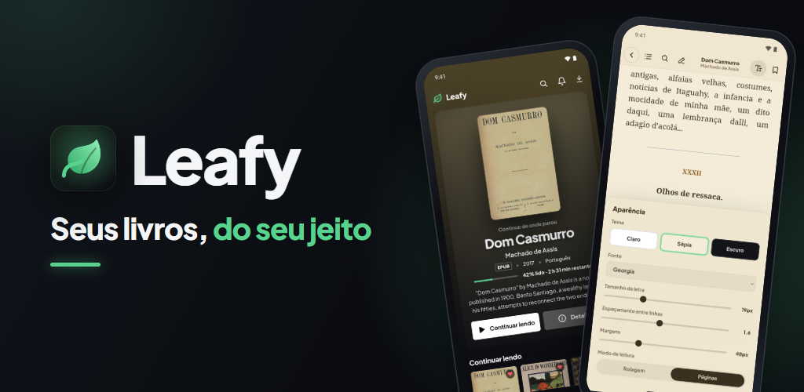

## Download

| Plataforma | Como instalar |
|---|---|
| **Windows 10 ou superior** | [Baixar o instalador](https://leafybook.app/baixar/windows). O app se atualiza sozinho. |
| **Android** | [Google Play](https://play.google.com/store/apps/details?id=com.leafybookreader.app) |

Versão atual: **2.1.2**.

## Telas

  

| | |
|---|---|
| 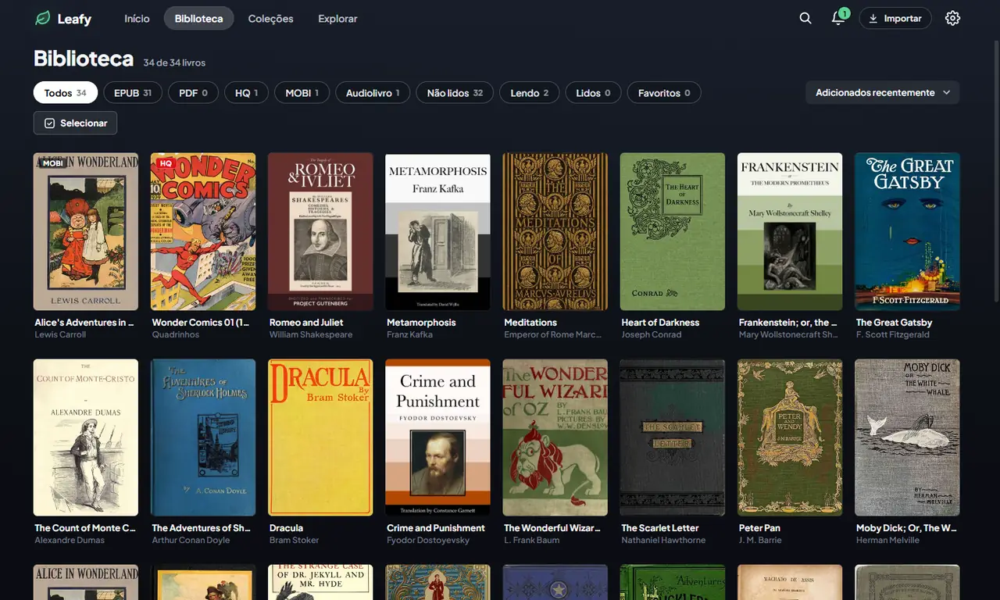 | 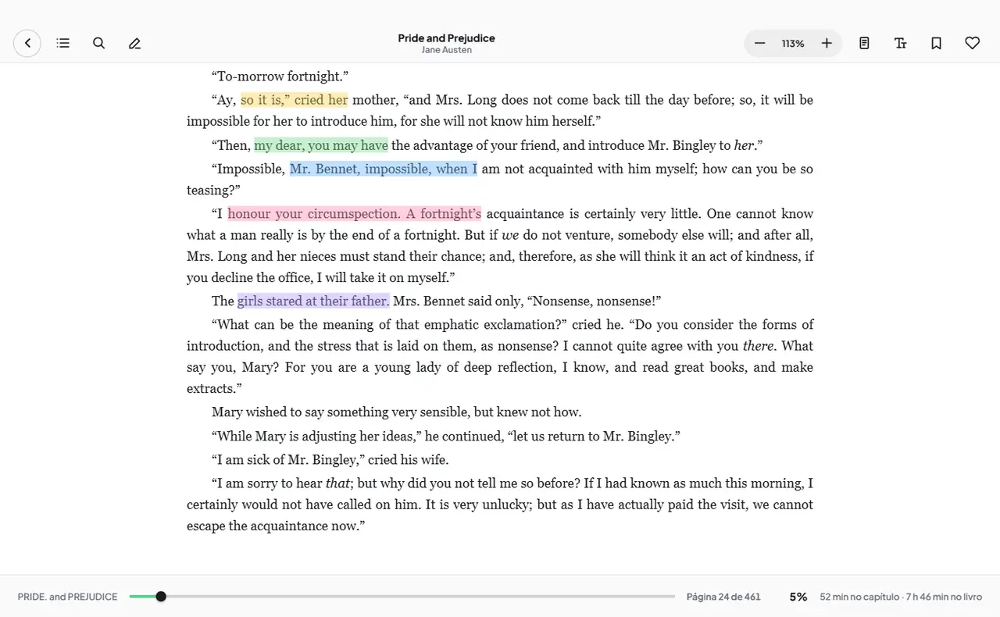 |
| **Biblioteca** com capas, coleções, autores e busca | **Marcações** em cores e notas no texto |
| 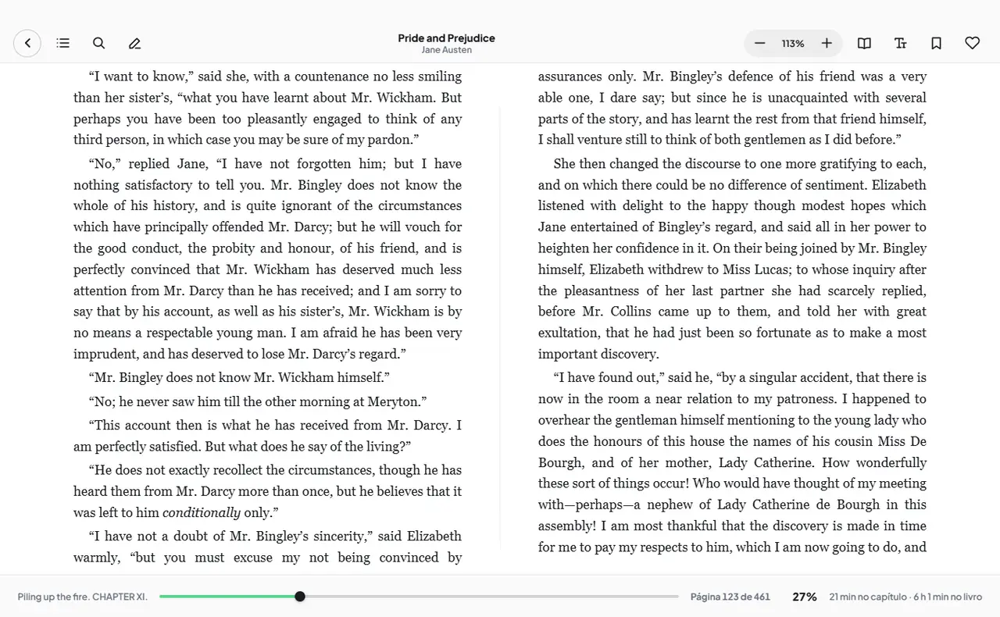 | 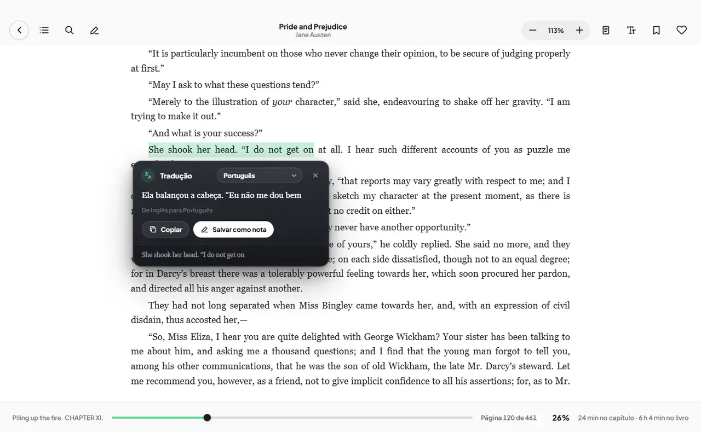 |
| **Uma ou duas páginas** lado a lado | **Tradução** do trecho selecionado |
| 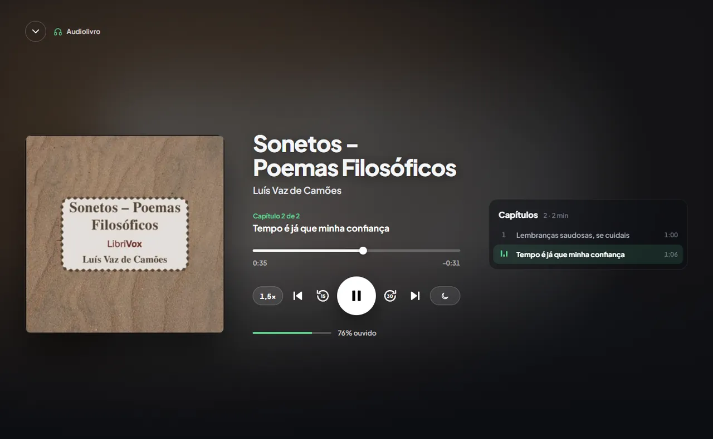 | 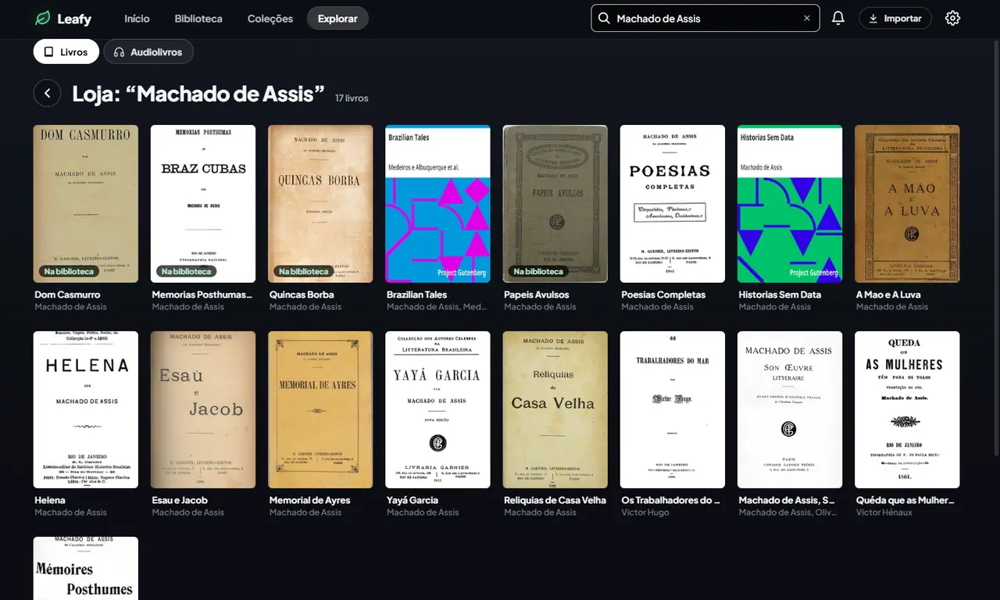 |
| **Audiolivros** com mini-player | **Explorar**: livros e audiolivros de domínio público |

### No celular

  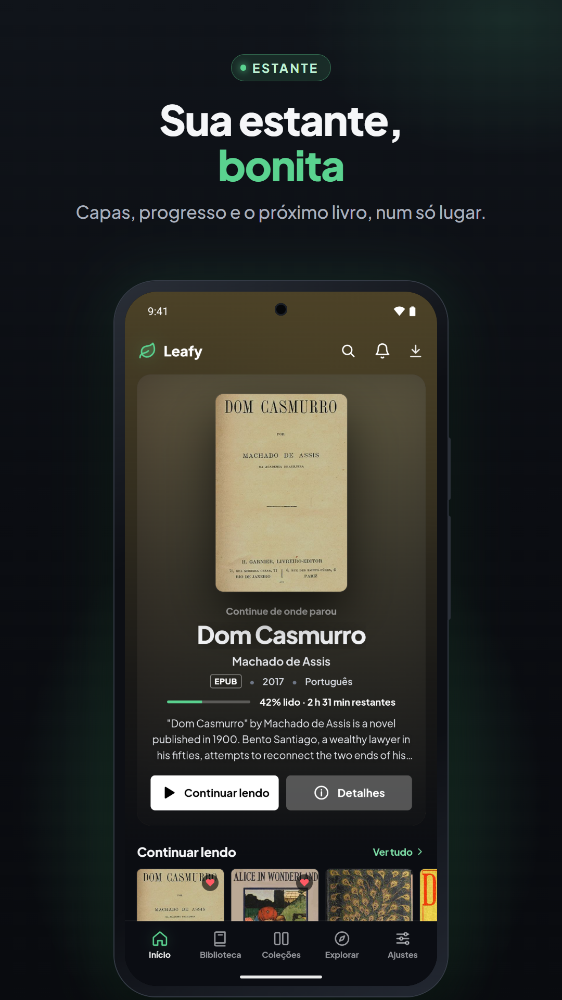
  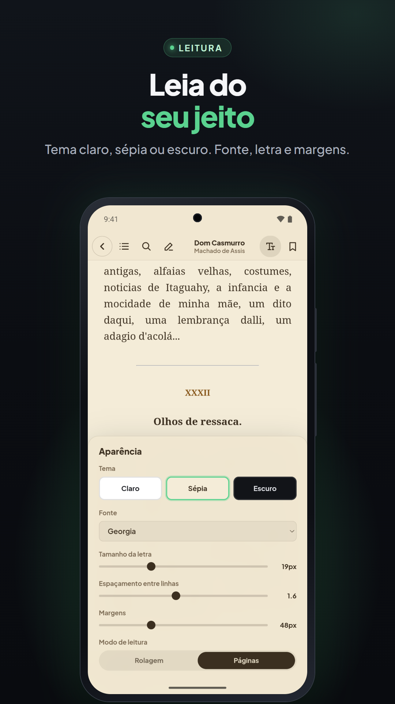
  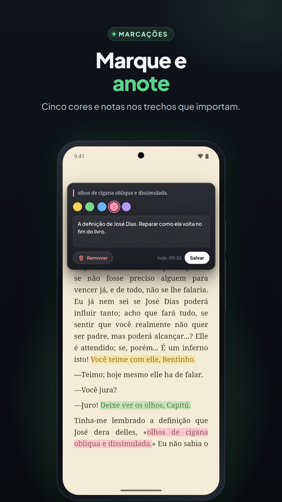
  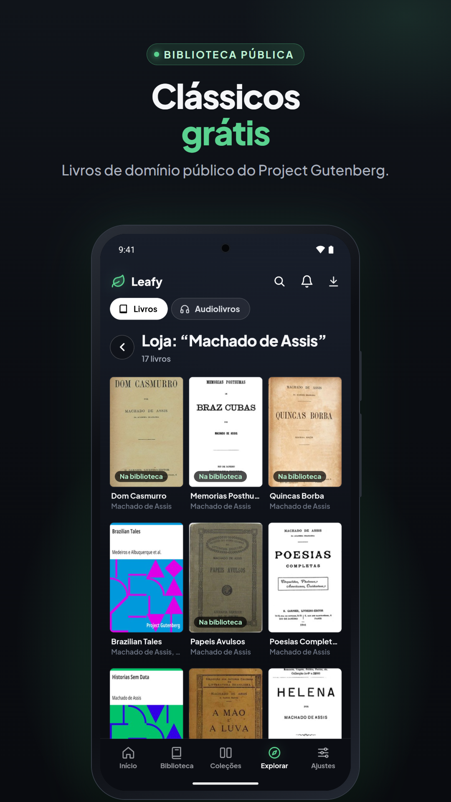

  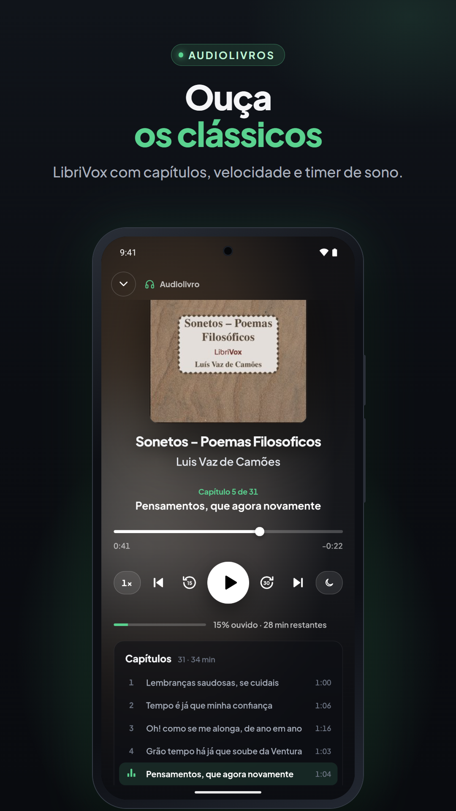
  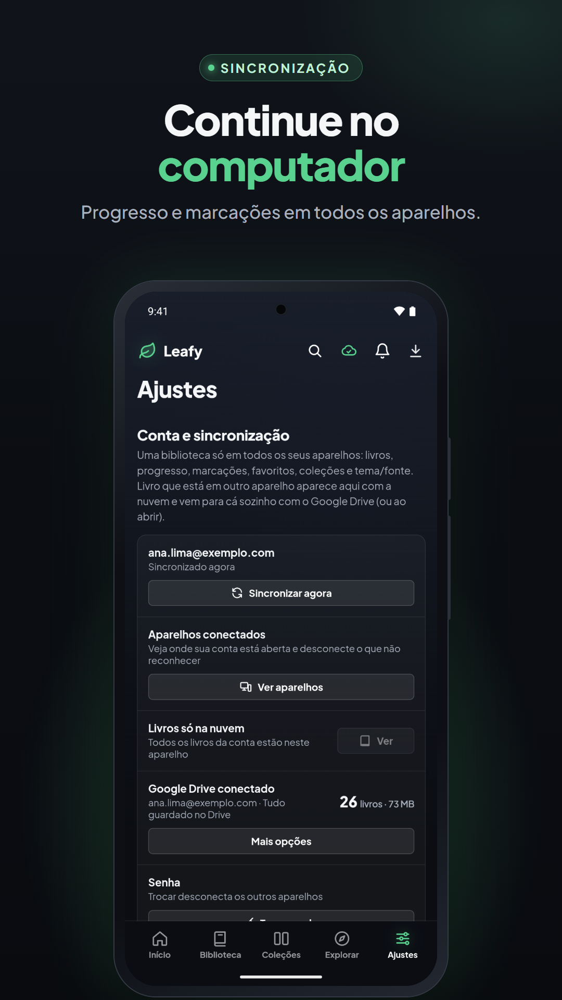
  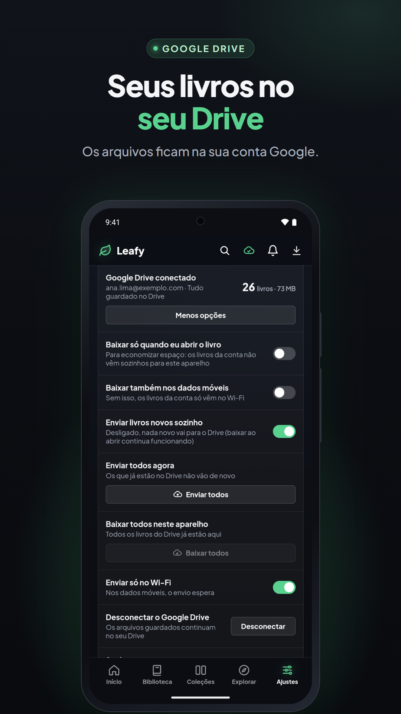

## O que o Leafy faz

**Formatos**
- 📖 EPUB, PDF, MOBI e AZW3
- 🗯️ Quadrinhos e mangás: CBZ, CBR e CB7
- 🎧 Audiolivros locais, com mini-player e reprodução em segundo plano

**Biblioteca**
- 🗂️ Importa uma pasta inteira de uma vez, sem duplicar, já com capa, título e autor
- 👀 Pode vigiar pastas e trazer livros novos sozinho
- ⭐ Coleções, favoritos, autores, busca e filtros
- ▶️ "Continuar lendo" com porcentagem lida e tempo restante

**Leitura**
- 🖍️ Marcações em cores, notas e marcadores
- 🌐 Tradução do trecho selecionado
- 📄 Uma ou duas páginas lado a lado, ou rolagem contínua
- 🌗 Temas claro e escuro, fonte e espaçamento ajustáveis
- 🔍 Busca dentro do livro

**Livros gratuitos**
- 📚 Catálogo de domínio público do Projeto Gutenberg
- 🎙️ Audiolivros do LibriVox

**Conta e sincronização (opcional)**
- 🔄 Uma biblioteca só no computador e no celular: livros, progresso, marcações, favoritos e coleções
- ☁️ Os arquivos dos livros ficam no **seu** Google Drive, na pasta Leafy. Não ficam nos nossos servidores.
- 🔐 Entrar com e-mail e senha ou com o Google

O Leafy é gratuito e não tem anúncios.

## Privacidade e suporte

- [Política de privacidade](https://leafybook.app/privacidade) · [Termos de uso](https://leafybook.app/termos) · [Excluir conta](https://leafybook.app/excluir-conta)
- Suporte: [leafybook.app/suporte](https://leafybook.app/suporte) ou **suporte@leafybook.app**

## Sobre este repositório

Este repositório guarda a página pública do Leafy e as versões antigas (0.0.x) na seção Releases.
As versões atuais são distribuídas pelo [site](https://leafybook.app) e pela Google Play.

> ⚠️ **Aviso legal**
> Este software é fornecido gratuitamente e "no estado em que se encontra", sem garantias de qualquer tipo.
